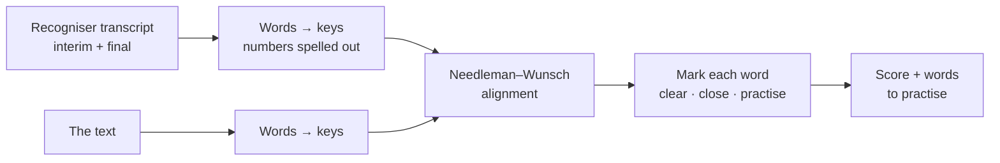

# Out Loud

[](https://github.com/FeruzaAbdukayumova/out-loud/actions/workflows/ci.yml)

A reading-practice app for people learning English. Read a text aloud and it marks each word as you go: clear, close, or one to practise. Tap any word to hear how it should sound.

**Live:** https://feruzaabdukayumova.github.io/out-loud/. It installs to your home screen.

## What it does

- **Live marking:** words light up while you read. Only real problems turn red, and only once the recogniser has settled on them.
- **Finishes by itself:** a few seconds after you stop talking (sooner once you reach the last word), with a countdown so it never cuts you off by surprise.
- **Hear any word:** tap a word in the text, or one of the "to practise" words after a reading. The whole text can be read aloud too.
- **Your own texts:** paste a text from a lesson or a book (up to 300 words). It's saved on the device.
- **Progress:** every reading is scored and kept. Each text shows its best score, and a new reading shows how it compares with the last one.

## How a reading is checked



- **Alignment, not word-by-word comparison.** The spoken words are lined up with the text using Needleman–Wunsch, with a similarity score from edit distance. A skipped or extra word then costs one mark instead of throwing off everything after it. The end gap is free: you've only read as far as you've read, so the unread rest of the text costs nothing. Without that, saying "I" could pair with the *last* "I" in the text and mark everything before it as skipped.
- **Numbers.** Recognisers write what they hear as digits: "I wake up at 7:00", "she is 6". The text says "seven o'clock" and "six". Both sides are turned into the words a reader actually says, covering times, ordinals, years, decimals and percentages. The single-file version threw digits away, so a perfect reading of "seven o'clock" was marked as two skipped words.
- **Sound-alikes.** The recogniser chooses a spelling from context, so "the sky is blue" read perfectly can come back as "blew". Words that sound the same (blue/blew, to/too/two, buy/by…) count as the same word.
- **Not marking too early.** While you read, the recogniser keeps revising its last few words. A word only turns red once you're two words past it. A long run of "skipped" words mid-reading usually means the recogniser is behind, not that you skipped a line, so those wait until the end.
- **A printed word can be several spoken words.** "21" is "twenty one", so the text keeps a list of spoken units, each pointing back to its printed word. A printed word is as good as its worst unit.

## Architecture

```
src/
  reading/   pure text logic: parsing, numbers → words, alignment, marking and scoring
  speech/    ReadingSession (listen → mark → auto-finish), the recogniser adapter, mic meter, speech output
  library/   IndexedDB: your own texts and the score history
  ui/        React components
```

Design decisions:

- **The browser's recogniser sits behind a three-method interface** (`start`, `stop`, and callbacks for text, problems and end). `ReadingSession` only sees that interface, so the whole reading flow, including restarts, errors and the auto-finish timer, is tested with a fake recogniser and fake timers.
- **The session is a small external store.** React reads it with `useSyncExternalStore`. The microphone level changes every frame, so it skips React and is written straight to the DOM.
- **The recogniser stops by itself now and then** (Chrome does after a pause, and when the page is hidden). The session restarts it and keeps what was heard. If it keeps ending straight away, the session stops and says so instead of restarting forever.
- **Long texts are spoken a sentence at a time,** because Chrome's online voices go silent about 15 seconds into a single utterance.

## Testing

```bash
npm test
```

- **Reading logic:** number spelling, text parsing, alignment, marking rules, scoring. One test streams a correct reading word by word and checks that no word ever turns red on the way.
- **Session:** live marking, auto-finish with countdown, finishing sooner at the end, recogniser restarts that keep what was heard, blocked mic, a recogniser that keeps stopping.
- **Library:** IndexedDB with `fake-indexeddb`: ordering, deleting a text with its history, last/best scores, the history cap.
- **UI flows** with Testing Library: read a text, compare with the last reading, tap a word, add and delete your own text, a browser without speech recognition.

- **End to end** with Playwright, on desktop and phone viewports, against the production build: a reading is marked live and remembered after a reload, auto-finish, your own texts, **works offline** through the service worker, no sideways scrolling, and an **axe accessibility scan** (WCAG 2 AA) before and after a reading. The browser gets a stand-in recogniser before the app loads, because a real one can't be made to listen to a test. The first axe run caught low-contrast grey and amber text that the original design had.

```bash
npm run e2e
```

CI runs typecheck, lint, unit tests, the build and the end-to-end tests on every push. Pushes to `main` deploy to GitHub Pages only if all of it passes.

## Browser support

Speech recognition works in Chrome, Edge and Safari. Chrome sends audio to Google's speech service, so it needs an internet connection. In other browsers the texts and the "hear it" buttons still work, and the app explains why it can't listen.

## Run locally

```bash
npm install
npm run dev
```

Node 22+. The microphone only works on `https://` or `localhost`.

## Stack

React 19 · TypeScript (strict) · Vite · Web Speech API (recognition and synthesis) · Web Audio API · IndexedDB (`idb`) · PWA (`vite-plugin-pwa`) · Vitest · Testing Library · Playwright · axe-core · oxlint · GitHub Actions
