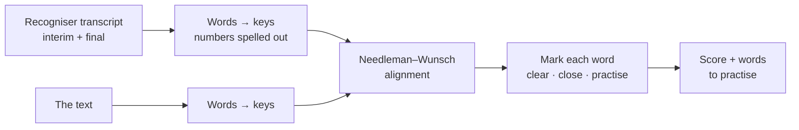
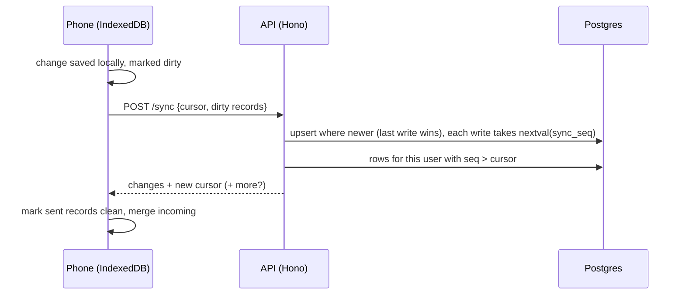

# Out Loud

[](https://github.com/FeruzaAbdukayumova/out-loud/actions/workflows/ci.yml)

A reading-practice app for people learning English. Read a text aloud and it marks each word as you go: clear, close, or one to practise. Tap any word to hear how it should sound.

**Live:** https://feruzaabdukayumova.github.io/out-loud/. It installs to your home screen.

## What it does

- **Live marking:** words light up while you read. Only real problems turn red, and only once the recogniser has settled on them.
- **Finishes by itself:** a few seconds after you stop talking (sooner once you reach the last word), with a countdown so it never cuts you off by surprise.
- **Hear any word:** tap a word in the text, or one of the "to practise" words after a reading. The whole text can be read aloud too.
- **Your own texts:** paste a text from a lesson or a book (up to 300 words). It's saved on the device.
- **Word practice:** words you miss go into a practice deck. They come back one at a time, with the sentence they came from, on a spaced schedule: a word said clearly returns in 1, 3, 7, then 16 days, and a missed one starts over.
- **Sync across devices:** sign in, and your texts, scores and practice words follow you between phone and computer. It's offline-first: everything works without a connection, and changes catch up when you're back online. Without an account, nothing leaves the device.
- **Progress:** every reading is scored and kept. Each text shows its best score, and a new reading shows how it compares with the last one.

## How a reading is checked



- **Alignment, not word-by-word comparison.** The spoken words are lined up with the text using Needleman–Wunsch, with a similarity score from edit distance. A skipped or extra word then costs one mark instead of throwing off everything after it. The end gap is free: you've only read as far as you've read, so the unread rest of the text costs nothing. Without that, saying "I" could pair with the *last* "I" in the text and mark everything before it as skipped.
- **Numbers.** Recognisers write what they hear as digits: "I wake up at 7:00", "she is 6". The text says "seven o'clock" and "six". Both sides are turned into the words a reader actually says, covering times, ordinals, years, decimals and percentages. The single-file version threw digits away, so a perfect reading of "seven o'clock" was marked as two skipped words.
- **Sound-alikes.** The recogniser chooses a spelling from context, so "the sky is blue" read perfectly can come back as "blew". Words that sound the same (blue/blew, to/too/two, buy/by…) count as the same word.
- **Not marking too early.** While you read, the recogniser keeps revising its last few words. A word only turns red once you're two words past it. A long run of "skipped" words mid-reading usually means the recogniser is behind, not that you skipped a line, so those wait until the end.
- **A printed word can be several spoken words.** "21" is "twenty one", so the text keeps a list of spoken units, each pointing back to its printed word. A printed word is as good as its worst unit.

## Word practice

A Leitner schedule (`src/practice/schedule.ts`, pure and tested). Every word starts in box 0, due now. Saying it clearly moves it up a box (due again in 1, 3, 7, 16 days), and past the last box it's learned and leaves the deck. Missing it sends it back to box 0. Two rules keep the schedule honest:

- **Only the first try at a word in a round counts.** You can retry as often as you like, but a word you needed three tries for isn't "known".
- **Reading a text clearly only counts as a review if the word was due.** Otherwise reading the same text twice in a row would fast-forward every word.

## Sync



- **Local first.** IndexedDB is the app's real database. Every record carries `updatedAt`, a `deleted` tombstone (so a delete reaches the other devices), and a `dirty` flag. A sync sends the dirty records and receives everything that changed since its cursor. A change made *while* a sync is in flight stays dirty, because a record is only marked clean if it hasn't changed since it was sent.
- **One cursor.** Every write on the server takes the next value of a single Postgres sequence, so "what changed since" is one number across all tables, and paging is one `UNION ALL … ORDER BY seq LIMIT n`. Concurrent transactions can commit sequence numbers out of order, which would let a client skip a row, so each user's syncs take a `pg_advisory_xact_lock` and run one at a time.
- **Conflicts:** last write wins per record. That's right for texts and practice cards, which one person edits. Attempts are append-only, with ids generated on the device.
- **When it syncs:** 1.5 s after the last local change, when the app comes back into view or online, and every 5 minutes while it's open.

## Server

`server/` is a small Node API: Hono, node-postgres, zod, and plain SQL migrations applied on start. It's deployed on Render (`render.yaml`) with the database on Neon.

- **Accounts:** email and password, hashed with argon2id. Sessions are random tokens of which only a SHA-256 hash is stored, they expire after 90 days, and an account can be deleted (everything synced for it goes too, through `on delete cascade`). The app and the API are on different sites, so the token is sent as a bearer header rather than a cookie, which browsers increasingly block across sites.
- **Rate limiting:** sign-in attempts per address, per account per address, and (looser) per account from anywhere. A wrong email and a wrong password look the same and take the same time. The limiter is a count-min sketch keyed with a secret HMAC, so it uses fixed memory, can't be filled or flushed by a flood of made-up keys, and can't be aimed at someone else's counter. The client address is taken from the entry Render's proxy adds to `X-Forwarded-For`, not one the client wrote. Several of these came out of security reviews of the first version; the commit history has the details.
- **Error reports:** the app sends uncaught errors (and ones its React error boundary catches) to `POST /errors`, rate-limited, with the table capped.
- **Tests** run against PGlite (Postgres compiled to WebAssembly, in-process) locally, and against both PGlite and a real Postgres 17 container in CI.

## Architecture

```
src/
  reading/   pure text logic: parsing, numbers → words, alignment, marking and scoring
  speech/    ReadingSession (listen → mark → auto-finish), the recogniser adapter, mic meter, speech output
  practice/  the spaced-repetition schedule (pure)
  library/   IndexedDB: texts, history, practice deck, sync bookkeeping (versioned schema, with upgrade tests)
  sync/      the Syncer (when and what to sync), the API client, error reporting
  ui/        React components
shared/      the sync contract, imported by both sides
server/      the API (see above)
e2e/         Playwright tests
```

Design decisions:

- **The browser's recogniser sits behind a three-method interface** (`start`, `stop`, and callbacks for text, problems and end). `ReadingSession` only sees that interface, so the whole reading flow, including restarts, errors and the auto-finish timer, is tested with a fake recogniser and fake timers.
- **The session is a small external store.** React reads it with `useSyncExternalStore`. The microphone level changes every frame, so it skips React and is written straight to the DOM.
- **The recogniser stops by itself now and then** (Chrome does after a pause, and when the page is hidden). The session restarts it and keeps what was heard. If it keeps ending straight away, the session stops and says so instead of restarting forever.
- **Long texts are spoken a sentence at a time,** because Chrome's online voices go silent about 15 seconds into a single utterance.

## Testing

```bash
npm test
```

- **Reading logic:** number spelling, text parsing, alignment, marking rules, scoring. One test streams a correct reading word by word and checks that no word ever turns red on the way.
- **Session:** live marking, auto-finish with countdown, finishing sooner at the end, recogniser restarts that keep what was heard, blocked mic, a recogniser that keeps stopping.
- **Library:** IndexedDB with `fake-indexeddb`: ordering, deleting a text with its history, last/best scores, the history cap.
- **UI flows** with Testing Library: read a text, compare with the last reading, tap a word, add and delete your own text, a browser without speech recognition.

- **Sync:** the Syncer with a fake server (debouncing, one sync at a time, paging, offline, an expired session) and the sign-in flow in the UI.
- **End to end** with Playwright, on desktop and phone viewports, against the production build and the real server (with an in-memory Postgres). **Two browser profiles act as two devices:** a text, a score and a practice word made on one appear on the other, a delete travels back, and changes made offline go up once the connection returns. Also: a reading is marked live and remembered after a reload, auto-finish, your own texts, practising a missed word, **works offline** through the service worker, no sideways scrolling, and an **axe accessibility scan** (WCAG 2 AA) before and after a reading. The browser gets a stand-in recogniser before the app loads, because a real one can't be made to listen to a test. The first axe run caught low-contrast grey and amber text that the original design had.

```bash
npm run e2e
```

CI runs typecheck, lint, unit tests, the build and the end-to-end tests on every push. Pushes to `main` deploy to GitHub Pages only if all of it passes.

## Browser support

Speech recognition works in Chrome, Edge and Safari. Chrome sends audio to Google's speech service, so it needs an internet connection. In other browsers the texts and the "hear it" buttons still work, and the app explains why it can't listen.

## Run locally

```bash
npm install
npm run dev                      # the app alone: everything but accounts

cd server && npm install
DATABASE_URL=memory ALLOWED_ORIGINS=http://localhost:5173 npm run dev   # the API, with a throwaway in-memory database
# then, in the root: VITE_API_URL=http://localhost:8787 npm run dev
```

Node 22+. The microphone only works on `https://` or `localhost`.

## Stack

**App:** React 19 · TypeScript (strict) · Vite · Web Speech API (recognition and synthesis) · Web Audio API · IndexedDB (`idb`) · PWA (`vite-plugin-pwa`) · Vitest · Testing Library · Playwright · axe-core · oxlint · GitHub Actions

**Server:** Node 22 · Hono · PostgreSQL (Neon) · node-postgres · zod · argon2 · PGlite for tests · Render
